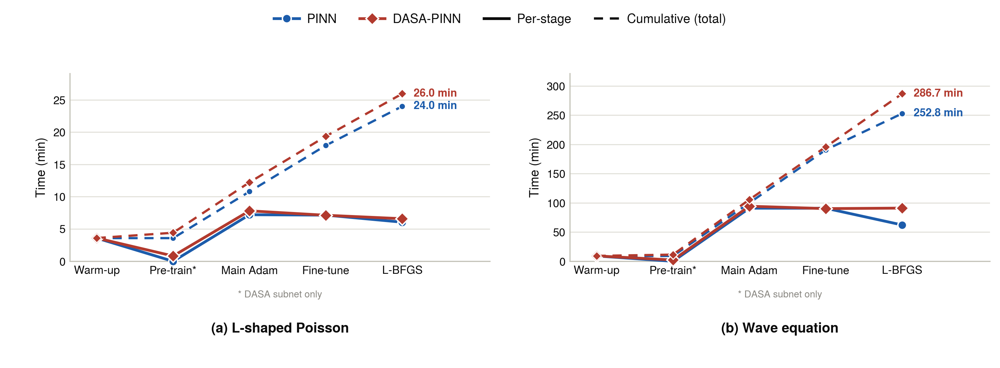

# L-shaped Poisson: PINN vs DASA Cost Summary

## Setup

- Hardware: NVIDIA A100-SXM4-80GB
- Seeds per method: 3
- PINN backbone: modified MLP, 6 hidden layers, width 128, tanh
- DASA backbone: the same modified MLP, 6 hidden layers, width 128, plus a 5x10 weighting subnet
- Reported errors: relative L2 error and maximum pointwise error
- Timing scope: all configured Adam stages and the complete L-BFGS stage

## Aggregate Results

All values are mean +/- sample standard deviation over three seeds.

**Figure: Stage-specific training time on the L-shaped Poisson and wave
equations.** Lines connect the mean time of S1, S2, S3, S4, and L-BFGS over
three seeds.
`Pre-train*` is a DASA-only weighting-subnetwork stage and is therefore not
applicable to PINN.
The panel annotation reports the complete training time. Timing includes all
configured Adam stages and the complete L-BFGS stage on an NVIDIA A100-SXM4-80GB.
Both methods use the same modified-MLP backbone; DASA adds only its weighting
subnet.

| Method | Trainable parameters | Main Adam time/step (ms) | Adam total (s) | Full training (s) | Relative L2 error | Maximum pointwise error | Peak GPU memory (MB) |
|---|---:|---:|---:|---:|---:|---:|---:|
| PINN | 83841 | 4.326553e+01 +/- 1.310495e+00 | 1.076883e+03 +/- 2.428877e+01 | 1.440363e+03 +/- 6.623937e+01 | 9.579940e-03 +/- 5.434215e-03 | 7.407195e-03 +/- 4.062915e-04 | 7.775081e+02 |
| DASA | 84321 | 4.687250e+01 +/- 9.525963e-01 | 1.161663e+03 +/- 1.622083e+01 | 1.557376e+03 +/- 6.486532e+01 | 8.484838e-03 +/- 4.738401e-03 | 6.860370e-03 +/- 8.006973e-04 | 7.775301e+02 |

## DASA Relative To PINN

| Quantity | Change |
|---|---:|
| Trainable parameters | +5.725122e-01% |
| Main-stage time per step | +8.336824e+00% |
| Adam total time | +7.872725e+00% |
| Full training time | +8.123860e+00% |
| Relative L2 error | -1.143120e+01% |
| Maximum pointwise error | -7.382356e+00% |

Negative error changes indicate lower error for DASA.

## Per-seed Full Training Time

| Seed | PINN (s) | DASA (s) |
|---:|---:|---:|
| 0 | 1.482751e+03 | 1.501983e+03 |
| 1 | 1.364032e+03 | 1.541413e+03 |
| 2 | 1.474307e+03 | 1.628733e+03 |

## Interpretation

DASA reduces the mean relative L2 error by 1.143120e+01% and the mean maximum
pointwise error by 7.382356e+00%, while increasing mean full training time by
8.123860e+00%. The timing comparison uses an identical modified-MLP backbone;
the DASA overhead therefore includes adversarial weighting and its 5x10
weighting subnet.
